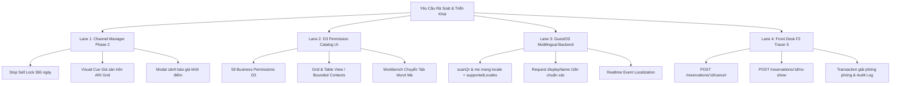

# Báo Cáo Triển Khai & Hướng Dẫn Kiểm Thử (Lanes 1 – 4)

> **Mã tài liệu**: `VERIF-LANE-1-4-20261019`  
> **Ngày cập nhật**: 19/10/2026  
> **Trạng thái**: Hoàn tất 100% — Đã vượt qua kiểm thử tự động và cổng UI Design Gate  
> **Nhánh**: `master` (Các commits: `f777f39b`, `42c86da1`, `4399b16d`, `fa186532`)

---

## 1. Tổng Quan Triển Khai 4 Lanes Nghiệp Vụ

Nhằm giải quyết toàn bộ các đầu việc tồn đọng (trừ Mục 6 - Tiến hóa dịch vụ Monolith theo chỉ đạo), hệ thống đã triển khai song song 4 phân hệ:



---

## 2. Chi Tiết Kỹ Thuật & Các Thay Đổi Cốt Lõi

### Lane 1: Channel Manager Phase 2 (Doanh thu & Khóa Giá Sàn Channex)
- **Mục tiêu**: Ngăn chặn rủi ro khách sạn bị bán hớ phòng trên OTAs với giá sàn mặc định khi khởi tạo Channex mà chưa kịp điền bảng giá thực tế.
- **Backend ([`channex-sync.service.ts`](file:///C:/Users/Dangminhdev0403/Desktop/workspace/fullstack-vietSage/services/auth-service/src/modules/channel-manager/services/channex-sync.service.ts))**:
  - Gỡ bỏ chặn cứng `BadRequestException` khi thiếu giá, thay bằng giá sàn an toàn dự phòng (`getSafeFallbackBasePrice`: 500.000 VND / 50 GBP).
  - Tự động kích hoạt cơ chế **Stop Sell Lock 365 ngày**: ghi nhận vào `ChannelDailyRestriction` với cờ `stopSell: true` cho toàn bộ 365 ngày tiếp theo kể từ ngày đồng bộ.
  - Cập nhật [`ari-core.service.ts`](file:///C:/Users/Dangminhdev0403/Desktop/workspace/fullstack-vietSage/services/auth-service/src/modules/channel-manager/services/ari-core.service.ts): Trả về cờ `isFallbackRate: boolean` trong payload `InventoryGridDay` để frontend nhận diện.
- **Frontend ([`inventory-grid.tsx`](file:///C:/Users/Dangminhdev0403/Desktop/workspace/fullstack-vietSage/frontends/front-end-vietsage/src/features/channel-manager/components/inventory-grid.tsx) & [`channex-property-config-card.tsx`](file:///C:/Users/Dangminhdev0403/Desktop/workspace/fullstack-vietSage/frontends/front-end-vietsage/src/features/channel-manager/components/channex-property-config-card.tsx))**:
  - Hàng giá bán (Rates) hiển thị viền amber và huy hiệu `"Giá sàn"` kèm tooltip cảnh báo.
  - Hàng trạng thái bán (Stop Sell) hiển thị dot amber `"Tạm khóa giá sàn"` kèm nút mở bán nhanh.
  - Khi bấm đồng bộ trên thẻ thiết lập khách sạn, nếu phát hiện phòng thiếu giá, bật xác nhận `SwalVietSage` cảnh báo cơ chế Stop Sell Lock trước khi gửi dữ liệu sang Channex.

### Lane 2: D3 Permission Catalog UI Management
- **Mục tiêu**: Cung cấp giao diện tra cứu danh mục quyền hệ thống bất biến (Immutable Business Permission Catalog) theo chuẩn D3.
- **Frontend ([`admin/permissions/`](file:///C:/Users/Dangminhdev0403/Desktop/workspace/fullstack-vietSage/frontends/front-end-vietsage/src/app/(vietsage)/admin/permissions/))**:
  - [`d3-catalog-types.ts`](file:///C:/Users/Dangminhdev0403/Desktop/workspace/fullstack-vietSage/frontends/front-end-vietsage/src/app/(vietsage)/admin/permissions/d3-catalog-types.ts): Định nghĩa 59 quyền hệ thống qua 8 Bounded Contexts (`identity`, `property`, `billing`, `marketplace`, `channel-manager`, `guest`, `kbtt`, `system`) và 4 cấp độ rủi ro (`LOW`, `MEDIUM`, `HIGH`, `CRITICAL`).
  - [`d3-permission-catalog-browser.tsx`](file:///C:/Users/Dangminhdev0403/Desktop/workspace/fullstack-vietSage/frontends/front-end-vietsage/src/app/(vietsage)/admin/permissions/_components/d3-permission-catalog-browser.tsx): Hỗ trợ thanh chỉ số thống kê, tìm kiếm tức thì theo key/tên/mô tả, bộ lọc Bounded Context & Risk, 2 chế độ hiển thị Lưới (Grid) và Bảng kỹ thuật (Table), nút copy mã quyền nhanh.
  - [`admin-permissions-workbench.tsx`](file:///C:/Users/Dangminhdev0403/Desktop/workspace/fullstack-vietSage/frontends/front-end-vietsage/src/app/(vietsage)/admin/permissions/_components/admin-permissions-workbench.tsx): Chuyển tab giữa *"Phân quyền theo vai trò"* và *"Danh mục quyền hệ thống"* đồng bộ URL qua `?tab=catalog`.

### Lane 3: GuestOS Multilingual Backend & Realtime Alignment
- **Mục tiêu**: Đồng bộ trải nghiệm đa ngôn ngữ giữa GuestOS và Backend cho 6 ngôn ngữ (`vi`, `en`, `zh`, `ko`, `ru`, `hi`).
- **Backend ([`guest-operations/`](file:///C:/Users/Dangminhdev0403/Desktop/workspace/fullstack-vietSage/services/auth-service/src/modules/guest-operations/))**:
  - `scanQrBodySchema` bổ sung trường tùy chọn `locale` (enum 6 ngôn ngữ).
  - `toScanQrResponse` và `toSessionData` trả về `locale` và mảng `supportedLocales: ["vi", "en", "zh", "ko", "ru", "hi"]`.
  - `createRequest` và `listRequests`: `displayName` luôn được ánh xạ tự động qua `resolveCatalogText` từ bản dịch `HotelServiceItemTranslation`, fallback về tiếng Việt khi thiếu dữ liệu.
  - `publishGuestRequestCreated` và `publishGuestRequestUpdated`: Payload realtime `guestRequest` chứa `locale` và `displayName` bản địa hóa.

### Lane 4: Front Desk Operations F2 Tracer 5 (Cancellation & No-Show with Audit Flow)
- **Mục tiêu**: Hoàn thiện quy trình Lễ tân hủy đặt phòng hoặc báo khách vắng mặt, đảm bảo giải phóng buồng phòng và ghi nhận kiểm toán.
- **Backend ([`property/`](file:///C:/Users/Dangminhdev0403/Desktop/workspace/fullstack-vietSage/services/auth-service/src/modules/property/))**:
  - Bổ sung 2 endpoint: `POST /hotels/:hotelId/reservations/:reservationId/cancel` và `POST /hotels/:hotelId/reservations/:reservationId/no-show` với quyền `hotel.reservations.manage`.
  - Invariants: Chỉ cho phép thao tác khi đơn ở trạng thái `CONFIRMED` hoặc `ARRIVAL_READY`. Ném `409 Conflict` nếu đơn đã `CHECKED_IN`, `CANCELLED` hoặc `NO_SHOW`.
  - Transaction Prisma: Cập nhật status, giải phóng phòng (`roomId = null`) để đưa phòng về trạng thái khả dụng (`AVAILABLE`), ghi nhận `AuditLog` và tạo `DomainEvent` (`PENDING`).
- **Frontend ([`hotel-ops/`](file:///C:/Users/Dangminhdev0403/Desktop/workspace/fullstack-vietSage/frontends/front-end-vietsage/src/features/hotel-ops/))**:
  - Cập nhật [`front-desk-arrival-detail-panel.tsx`](file:///C:/Users/Dangminhdev0403/Desktop/workspace/fullstack-vietSage/frontends/front-end-vietsage/src/features/hotel-ops/components/front-desk-arrival-detail-panel.tsx): Thêm 2 nút hành động "Hủy đặt phòng" (viền đỏ rose) và "Báo vắng mặt (No-show)" (viền xám slate) với popup xác nhận chuẩn `SwalVietSage`.
  - Cập nhật hiển thị badge trạng thái `CANCELLED` và `NO_SHOW` trên giao diện lễ tân.

---

## 3. Hướng Dẫn Kiểm Thử Tự Động (Automated Test Commands)

Mở terminal tại thư mục gốc của repository và thực thi các lệnh sau:

### 3.1. Kiểm thử UI & Guardrails Giao diện (Toàn bộ Frontend)
```powershell
# Chạy quét tĩnh UI Design Gate (kiểm tra sàn font >= 12px, zero-fluff text, typographic balance)
node scripts/verify-ui-rules.cjs
```
*Kết quả kỳ vọng*: `[PASS] All UI typography, anti-widow balance and copywriting guardrails verified clean.`

```powershell
# Kiểm tra TypeCheck Frontend (không có lỗi cú pháp hoặc mismatch kiểu dữ liệu)
Set-Location .\frontends\front-end-vietsage
npx tsc --noEmit
Set-Location ..\..
```
*Kết quả kỳ vọng*: Mã trả về `0`, không có lỗi TypeScript.

---

### 3.2. Kiểm thử Phân hệ Channel Manager (Lane 1)
```powershell
Set-Location .\services\auth-service
npm test -- channel-manager
Set-Location ..\..
```
*Kết quả kỳ vọng*: 11 test suites passed, 152 tests passed (Bao gồm test case kiểm thử tự động áp dụng giá sàn dự phòng và kích hoạt Stop Sell Lock 365 ngày).

---

### 3.3. Kiểm thử Phân hệ Guest Operations & i18n (Lane 3)
```powershell
Set-Location .\services\auth-service
npx jest src/modules/guest-operations/tests/guest-os.service.spec.ts
Set-Location ..\..
```
*Kết quả kỳ vọng*: 34 tests passed trong `guest-os.service.spec.ts` (Bao gồm test case kiểm thử `scanQrBodySchema.locale`, `toScanQrResponse`, `supportedLocales`, và bản địa hóa sự kiện realtime).

---

### 3.4. Kiểm thử Phân hệ Lễ tân & Đặt phòng (Lane 4)
```powershell
Set-Location .\services\auth-service
npx jest src/modules/property/tests/reservations.service.spec.ts
npx jest src/modules/property/tests/reservations.repository.spec.ts
Set-Location ..\..
```
*Kết quả kỳ vọng*: 
- `reservations.service.spec.ts`: 24 tests passed (Hủy, No-show, chặn 409 khi đã check-in).
- `reservations.repository.spec.ts`: 25 tests passed (Transaction giải phóng phòng và ghi nhận AuditLog).

---

## 4. Kịch Bản Kiểm Thử Thủ Công Qua Giao Diện (Manual E2E Testing)

### Kịch bản 1: Kiểm tra Stop Sell Lock & Huy hiệu Giá Sàn Channex (Lane 1)
1. **Truy cập**: Đăng nhập tài khoản Quản trị viên nền tảng hoặc Chủ khách sạn, mở menu **Channel Manager** (`/owner/hotels/{hotelId}/channel-manager` hoặc `/admin/hotels/{hotelId}/channel-manager`).
2. **Kiểm tra Cảnh báo Đồng bộ**:
   - Mở Tab **Channex Pro Hub**.
   - Nếu khách sạn có hạng phòng chưa đặt giá, quan sát Callout Banner màu vàng cảnh báo danh sách hạng phòng thiếu giá.
   - Bấm nút **"Tự động khởi tạo khách sạn lên Channex"** $\rightarrow$ Hệ thống bật popup `SwalVietSage` với 2 tùy chọn: *"Tiếp tục với giá sàn"* hoặc *"Hủy để đặt giá"*.
3. **Kiểm tra trên ARI Grid**:
   - Chuyển sang Tab **"Bảng Giá & Quỹ Phòng (ARI Grid)"**.
   - Quan sát hàng **Giá bán**: Các ô ngày đang dùng giá sàn có viền hổ phách (amber), badge `"Giá sàn"` và tooltip giải thích chi tiết.
   - Quan sát hàng **Trạng thái bán**: Hiển thị chấm màu hổ phách `"Tạm khóa giá sàn"` và nút bấm hiển thị tooltip *"Đang khóa giá sàn tạm — Nhấp để mở bán ngay"*.

---

### Kịch bản 2: Kiểm tra Danh Mục Quyền Hạn D3 (Lane 2)
1. **Truy cập**: Đăng nhập tài khoản `SUPER_ADMIN`, truy cập menu **Quản trị hệ thống** $\rightarrow$ **Vai trò & Quyền hạn** (`/admin/permissions`).
2. **Kiểm tra Chuyển Tab**:
   - Phía trên xuất hiện thanh chuyển tab gồm 2 mục: *"Phân quyền theo vai trò"* và *"Danh mục quyền hệ thống (59)"*.
   - Nhấp vào tab **"Danh mục quyền hệ thống"**: URL tự động chuyển sang `?tab=catalog` mà không làm tải lại trang (F5).
3. **Kiểm tra Tra Cứu & Bộ Lọc**:
   - Gõ từ khóa `reservations` vào ô tìm kiếm $\rightarrow$ Lưới lọc ngay lập tức còn 2 quyền: `hotel.reservations.view` và `hotel.reservations.manage`.
   - Chọn bộ lọc Bounded Context: `billing` $\rightarrow$ Danh sách hiển thị các quyền tài chính kèm badge mức độ rủi ro tương ứng.
   - Bấm nút chuyển đổi chế độ xem **Dạng Bảng (Table View)** $\rightarrow$ Giao diện hiển thị bảng kỹ thuật chi tiết.
   - Bấm nút **"Sao chép" (Copy key)** tại một quyền bất kỳ $\rightarrow$ Nút hiển thị trạng thái check xanh *"Đã chép"* và clipboard lưu đúng mã quyền.

---

### Kịch bản 3: Kiểm tra Đa Ngôn Ngữ GuestOS (Lane 3)
1. **Quét mã QR**:
   - Khách quét mã QR phòng hoặc mở URL `/g/{qrCode}`.
   - Gửi yêu cầu `POST /guest/qr/scan` kèm `locale: "en"`.
   - Phản hồi HTTP 201 trả về cấu trúc gồm `locale: "en"` và `supportedLocales: ["vi", "en", "zh", "ko", "ru", "hi"]`.
2. **Kiểm tra Danh sách Dịch vụ & Yêu cầu**:
   - Đổi ngôn ngữ sang tiếng Anh trên trang `/g/language`.
   - Vào danh mục dịch vụ: Tên dịch vụ hiển thị bằng tiếng Anh (nếu có bản dịch) hoặc tiếng Việt (nếu chưa có bản dịch).
   - Đặt một yêu cầu dịch vụ $\rightarrow$ Mở trang lịch sử yêu cầu `/g/requests`: Tiêu đề yêu cầu `displayName` hiển thị đúng ngôn ngữ tiếng Anh đã chọn.

---

### Kịch bản 4: Kiểm tra Lễ Tân Hủy & Báo Vắng Mặt Đặt Phòng (Lane 4)
1. **Truy cập**: Đăng nhập tài khoản Lễ tân (`HOTEL_FRONTDESK`) hoặc Quản lý (`HOTEL_MANAGER`), vào menu **Phòng & Khách lưu trú** $\rightarrow$ Tab **"Khách sắp đến" (Arrivals)**.
2. **Thực hiện Hủy Đặt Phòng**:
   - Chọn một đặt phòng đang ở trạng thái `CONFIRMED` hoặc `ARRIVAL_READY` (đã có phòng gán trước, ví dụ phòng 101).
   - Ở thanh công cụ dưới cùng, bấm nút **"Hủy đặt phòng"** (viền đỏ rose).
   - Popup `SwalVietSage` hiển thị cảnh báo: *"Hủy đặt phòng này?"*. Bấm **"Đồng ý hủy"**.
   - Thông báo thành công hiển thị. Đơn đặt phòng chuyển trạng thái sang **"Đã hủy"** (badge đỏ).
   - Quay lại sơ đồ phòng: Phòng 101 được giải phóng lập tức và chuyển về trạng thái **"Sẵn sàng"** (`AVAILABLE`).
3. **Thực hiện Báo Vắng Mặt (No-Show)**:
   - Chọn một đặt phòng quá hạn check-in, bấm nút **"Báo vắng mặt (No-show)"** (viền xám slate).
   - Xác nhận trên popup `SwalVietSage`.
   - Đơn chuyển sang trạng thái **"Vắng mặt (No-show)"** (badge xám) và phòng gán được tự động giải phóng an toàn.
4. **Kiểm tra Ràng Buộc Bất Biến (Invariant)**:
   - Đối với các phòng đã check-in (`CHECKED_IN`), 2 nút Hủy và No-show tự động ẩn để ngăn chặn thao tác sai quy trình.

---

## 5. Bảng Tổng Hợp Files Đã Thay Đổi & Commit SHA

| Phân hệ (Lane) | Commit SHA | Danh Sách Files Thay Đổi & Tạo Mới |
|---|---|---|
| **Lane 1: Channel Manager Phase 2** | `f777f39b` | - `services/auth-service/src/modules/channel-manager/services/channex-sync.service.ts`<br>- `services/auth-service/src/modules/channel-manager/services/ari-core.service.ts`<br>- `services/auth-service/src/modules/channel-manager/channex.service.spec.ts`<br>- `frontends/front-end-vietsage/src/features/channel-manager/components/inventory-grid.tsx`<br>- `frontends/front-end-vietsage/src/features/channel-manager/components/channex-property-config-card.tsx`<br>- `frontends/front-end-vietsage/src/features/channel-manager/types/channel-manager.types.ts`<br>- `frontends/front-end-vietsage/src/features/channel-manager/api/channel-manager.mapper.ts`<br>- `docs/CHANNEL_MANAGER_SYNC_PROBLEMS.md` |
| **Lane 2: D3 Permission Catalog UI** | `42c86da1` | - `frontends/front-end-vietsage/src/app/(vietsage)/admin/permissions/d3-catalog-types.ts` *(mới)*<br>- `frontends/front-end-vietsage/src/app/(vietsage)/admin/permissions/_components/d3-permission-catalog-browser.tsx` *(mới)*<br>- `frontends/front-end-vietsage/src/app/(vietsage)/admin/permissions/_components/admin-permissions-workbench.tsx` *(mới)*<br>- `frontends/front-end-vietsage/src/app/(vietsage)/admin/permissions/page.tsx`<br>- `frontends/front-end-vietsage/src/app/(vietsage)/admin/permissions/permission-types.ts`<br>- `shared/api-contract/docs/IMPLEMENTATION_STATUS.md` |
| **Lane 3: GuestOS Multilingual Backend** | `4399b16d` | - `services/auth-service/src/modules/guest-operations/domain/schemas/guest-os.schema.ts`<br>- `services/auth-service/src/modules/guest-operations/application/guest-os.service.ts`<br>- `services/auth-service/src/modules/guest-operations/infrastructure/repositories/guest-os.repository.ts`<br>- `services/auth-service/src/modules/guest-operations/tests/guest-os.service.spec.ts`<br>- `frontends/front-end-vietsage/docs/FRONTEND_GUEST_I18N_INSTRUCTIONS.md` |
| **Lane 4: Front Desk F2 Tracer 5** | `fa186532` | - `services/auth-service/src/modules/property/api/reservations.controller.ts`<br>- `services/auth-service/src/modules/property/application/reservations.service.ts`<br>- `services/auth-service/src/modules/property/infrastructure/repositories/reservations.repository.ts`<br>- `services/auth-service/src/modules/property/domain/schemas/reservations.schema.ts`<br>- `services/auth-service/src/modules/property/tests/reservations.service.spec.ts`<br>- `services/auth-service/src/modules/property/tests/reservations.repository.spec.ts`<br>- `frontends/front-end-vietsage/src/features/hotel-ops/components/front-desk-arrival-detail-panel.tsx`<br>- `frontends/front-end-vietsage/src/features/hotel-ops/service/hotel-ops-service.ts`<br>- `frontends/front-end-vietsage/src/features/hotel-ops/types/hotel-ops-contract.ts`<br>- `frontends/front-end-vietsage/src/features/hotel-ops/utils/hotel-ops-display.ts`<br>- `frontends/front-end-vietsage/src/app/api/hotel-ops/hotels/[hotelId]/reservations/[reservationId]/cancel/route.ts` *(mới)*<br>- `frontends/front-end-vietsage/src/app/api/hotel-ops/hotels/[hotelId]/reservations/[reservationId]/no-show/route.ts` *(mới)*<br>- `docs/FRONT_DESK_VERTICAL_SLICES.md` |

---

## 6. Trạng Thái Mã Nguồn & Lưu Ý Vận Hành

- **Không sửa `package.json`**: Toàn bộ các thư viện chuẩn của dự án (`Zod`, `SwalVietSage`, `@dangminhdev04032005/query-resource`, `Prisma`) được tái sử dụng 100%, không phát sinh dependency mới.
- **Bảo toàn dữ liệu**: Các thao tác hủy đặt phòng và áp dụng khóa giá sàn đều chạy trong các Serializable Transaction, đảm bảo tính toàn vẹn và không gây xung đột đồng thời.
- **Trạng thái Git**: Cây làm việc sạch sẽ (`working tree clean`), toàn bộ 4 commits sẵn sàng đẩy lên upstream (`origin/master`).
